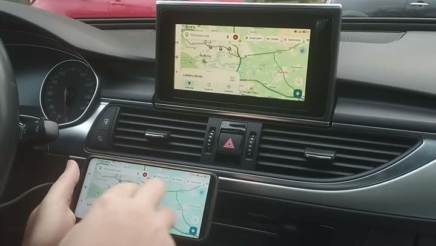
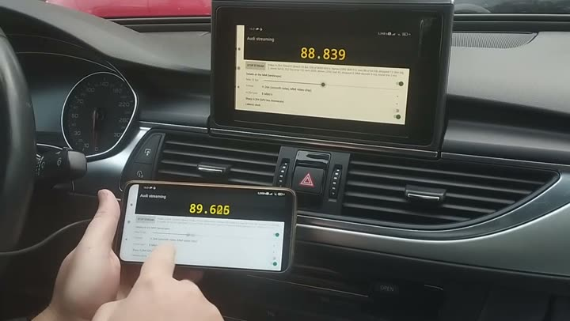
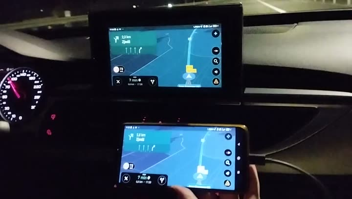
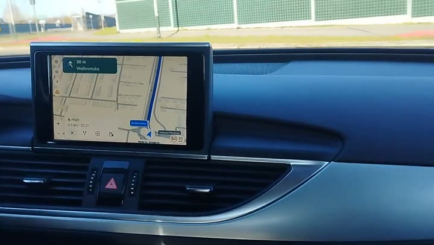

# audi_stream_receiver

The phone's screen on the MMI over USB. The Android app (`android/`, "Audi
streaming") captures its screen and sends it over Android Open Accessory
(AOA): as hardware H.264 (default) decoded by the DM642, or as JPEG pictures
decoded on the CPU. The phone app also has an Android Auto mode
([docs/android-auto.md §4.3](../../docs/android-auto.md)); the MMI side is the same.

```
phone: android/ app  --USB (AOA bulk)-->  MMI: audi_stream_receiver  -->  screen + log
```

- **Run:** `audi_stream_receiver <sd_path>` — runs until the SD card is
  pulled or SIGTERM/INT/HUP, so it is always the last app of a run.
- **Output** (`var/`): `audi_stream_receiver.log` (previous run kept as `.prev.log`),
  `usb_slog_<time>.txt` at a failed handshake / removal / io-media error (up to 6),
  `usb_slog_periodic_<time>.txt` every 60 s while streaming. `<time>` is time since boot.
- **Build:**

  ```sh
  make sd SD_APPS=audi_stream_receiver
  make test          # protocol, pictures, JPEG, live stream, camera tracker
  make apk           # android/out/audi_streaming.apk; make apk-test, make apk-install
  make aoa-host      # desk test: the PC plays the MMI (stop host adb first)
  ```

  The APK and the SD card must come from the same build.

## Using it

1. Install the APK, insert the SD card: the MMI says *Waiting for phone*.
2. Plug the phone in and accept "open Audi streaming": the bar turns green, *Connected*.
3. Tap **Stream screen** and allow the capture. *Format* picks H.264 (default) or JPEG.
4. Rotating, Back/Home, unplug/replug keep the stream going. Stop it in the
   app; pull the SD card to end the MMI side.

## How it works

- **USB:** io-usb with a wildcard filter, AOA handshake with any new device;
  the phone's `accessory_filter.xml` matches `mmi3g` / `audi_stream_receiver`.
  Non-Android devices, unplugging and transfer errors never end the app
  ([docs/usb-stack.md](../../docs/usb-stack.md)).
- **Protocol** (`proto.h` = `android/.../Proto.kt`): `type u8 | len u16 LE | payload`,
  max 2048 B. `HELLO`, `VIDEO_CAPS` (boxes, formats, limits), `VIDEO_START` +
  `VIDEO_DATA`, batched `VIDEO_ACKS`, `VIDEO_STOP`, `H264_CONFIG`, `H264_STATUS`
  (`PLAYING`/`SYNC`/`REFUSED`/`CONFIG`), `STREAM_SETTINGS` (phone settings, logged only).
  **Retired, never reuse:** `0x02` TEXT, `0x03` ACK, `0x08` VIDEO_ACK, `0x0A` status bar,
  `VIDEO_CAPS` format bit 1 (PNG).
- **JPEG:** the phone captures at k× and box-averages k:1 (sharp text), JPEG
  q90. The MMI decodes on the main thread (stb_image), copies only changed
  row spans into the VFB, and caps itself at 5 pictures a second and ≤ 50 %
  main-thread duty by holding acks (`jpeg_pacer.h`).
- **H.264** (`hwvideo.cpp`, `src/common/hw_stream.h`): 720×432 Baseline from
  the phone's MediaCodec → CS-MP4 stream served by our own resource manager
  at `/dev/audi_stream/live.mp4` → io-media → VCAP 0 input 1. 25 fps stream
  clock with skip-frame gap fill; a clock cap (> 500 ms ahead) and an io-media
  catch-up (> 12 frames behind) drop frames and resume from an IDR. Frames
  are capped at 128 KB. Up to 3 io-media errors per 60 s restart the stream,
  then `REFUSED` (JPEG fallback). Details:
  [docs/phone-mirroring.md §7.10–7.13](../../docs/phone-mirroring.md).
- **Rear camera:** `common/camera.cpp` follows the camera from dev-videoctrl's
  slog lines; while it is up the app writes nothing to VP1 and shows
  nothing, and retakes the screen 1 s after it ends
  ([docs/rear-camera.md §9](../../docs/rear-camera.md)).
- **Logging:** hot threads only write to a RAM ring (`perf.cpp`); a
  low-priority thread writes the log. `slogmark.h` writes markers with the
  log's time into the system log.

## Log lines

| Line | What |
|---|---|
| `rx HELLO ... build <v>` | the phone app's version: check it first |
| `rx STREAM_SETTINGS` | the phone's settings (format, fps, bit rate, frame size, …) |
| `cpu:` (10 s) | app and unit CPU, per thread, free RAM, heap; ` - HIGH` at ≥ 50 % own load |
| `perf: window` (10 s) / `perf: stream` | JPEG: fps, dropped, bad, rx/decode/render/copy/flip/latency ms, cap holds |
| `h264: config:` | the stream's frame cap and size |
| `h264: 10.0 s:` | frames in, skips, io-media reads/waits/lead, `lag min/median/max`, reader behind, data rate |
| `h264: stream ended` | totals: refused, bad, ahead of the clock, catch-up, evicted |
| `h264: at the error:` | on an io-media ERROR: last 32 reads, last 16 events, slog snapshot |
| `h264: tx H264_STATUS REFUSED (reason)` | why H.264 was refused |
| `camera:` / `videoctrl` | rear camera on/off, VCAP changes |

`lag` is MMI-side only (io-media's queue); the phone's capture, encoder and USB are not in it.

## Results

| | |
|---|---|
|  |  |
| Mirroring (Google Maps) | Latency check: stopwatch on phone vs MMI |
|  |  |
| Full-screen mirroring while driving | Android Auto mode (phone screen off) |

**Works**
- AOA end to end (Redmi Note 8 Pro); reconnects on its own.
- JPEG: 2–4 fps (set by the phone), latency 80–160 ms, rotation works, 0 bad.
- H.264: 720×432, sharp text, 22–25 fps, lag ~500 ms (~1.1 s on a session's
  first stream), MMI CPU ~30 % (receiver 6–9 %).
- Rear camera takes the screen and the stream comes back after it.

**Doesn't work / known**
- Landscape only for H.264 (portrait shows a "turn the phone" card).
- The stream stops when the phone locks (Android revokes the capture);
  *Keep screen on* avoids the timeout lock.
- Rotation or frame-size growth restarts the graph, often several times.
- 256 KB frames made io-media fall behind and fail ~45 s in: hence the 128 KB cap.

**Built, not yet confirmed on the car**
- JPEG cap, slog markers, restart after an io-media error, io-media catch-up.
