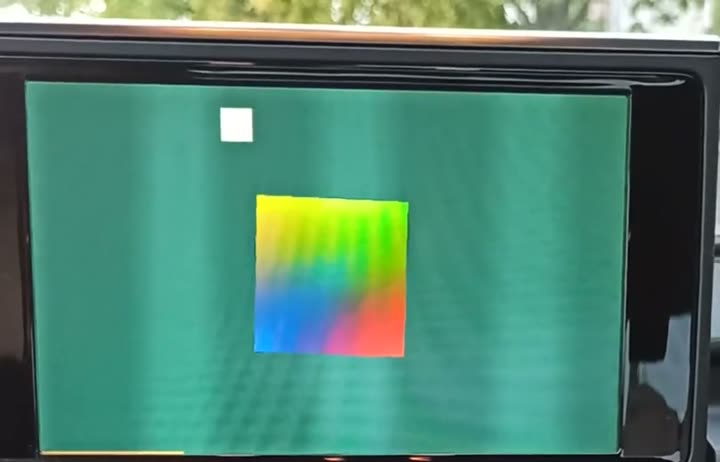

# hello2

OpenGL ES bring-up: ES-CM 1.0 on the screen for 20 s (`src/common/gfx.c`),
full EGL/GL diagnostics.

- **Run:** `hello2 <sd_path> [seconds]`
- **Output:** `var/hello2.log`

## Verifies

- Taking over the screen through the layer manager (displayable 40) and handing it back.
- EGL/GL bring-up and the driver's capabilities.
- Frame rate of a simple animation.

## Results

**Works**
- 800×480 BGRA8888, 60 Hz, 8 layers; layer manager 1.1.
- EGL 1.3 (NVIDIA), `OpenGL ES-CM 1.0`, depth 24 + stencil 8.
- 57–59 fps, no swap failures, no GL errors.

**Doesn't work**
- No user clip planes.

Details: [docs/gpu-results.md](../../docs/gpu-results.md).
