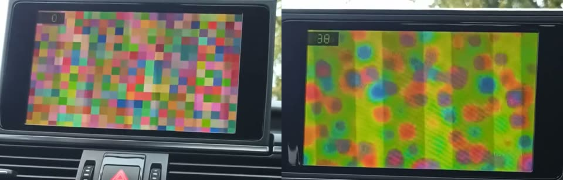

# hello3

GPU canvas and fill-rate benchmark: three scenes drawn entirely by the GPU
from two textures uploaded once (random blocks, a blended plasma, 1–32
full-screen blended layers).

- **Run:** `hello3 <sd_path> [scene_seconds]` (default 10)
- **Output:** `var/hello3.log` (fps, fill-rate table)

## Verifies

- Texture-matrix animation and blending with no per-frame uploads.
- Blended fill rate at 800×480.

## Results

**Works**
- Pixels scene 57 fps, plasma 38 fps, no GL errors.
- Fill rate: 57 fps up to 2 layers, then fill-bound; up to 132 Mpixel/s at 32 layers.

Details: [docs/gpu-results.md](../../docs/gpu-results.md).
