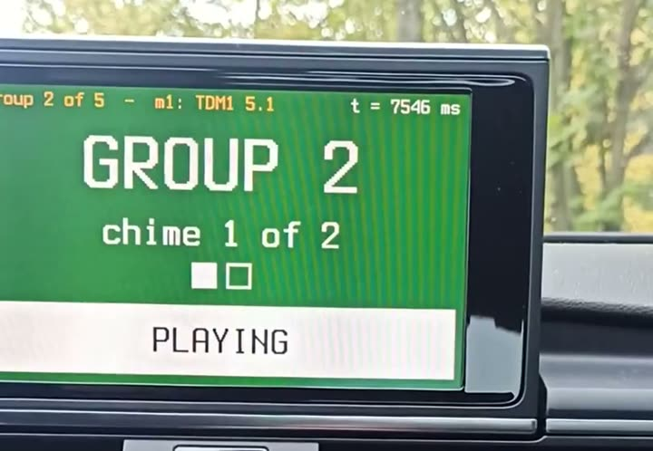

# hello5

Sound from an app. Plays a generated ping train (`pulse.c`: 0.5 s ping every
2 s) on io-media's `mixer:DSPOUT_TDM1_20_SAD`, one step at a time, each with
an on-screen question for the listener.

- **Run:** `hello5 <sd_path> [steps] [outputs]` (default steps `mntv`; the card runs `pd`)
- **Output:** `var/hello5.log` (`RESULT` lines), `hello5_<step>.log`, step `p`/`d` dumps
  (`hello5_ipc.txt`, `hello5_pidin.txt`, `hello5_broker.txt`, `hello5_helper.log`, …)
- **Screen:** steps `p` and `d` show what they are doing now. Step `p`:
  which tool or listing runs and how long it may take. Step `d`: what the
  helper does (`ConnectRequest to chid 14, server id 0x00020027`, …), for
  how long so far, when hello5 gives up on it, and its last note (`try 1
  of 2: …`), redrawn every second. The same lines are in the logs
  (`step p: now …`, `helper -> wait …`).

## Verifies

- `m`: does our sound mix with the radio or replace it?
- `n`: hello5's own io-media client (`iom.c`): own volume, queued files, event timing.
- `t`: does it play over Bluetooth music?
- `v`: does it follow the car's volume knob?
- `g`: which mixer outputs / io-audio devices are audible (N chimes on output N).
- `p`: which channels MMI3GApplication, MMI3GNavigation and the servicebroker
  connect to and receive on (`ipcprobe.c`).
- `d`: sound over a lowered radio: ask audio management for the nav voice
  channel over HBDSI, as the navigation does, and play on io-audio `navi`.

## Results

**Works**
- `TDM1_20_SAD` is heard clearly, with the radio or Bluetooth music on.
- Its level follows the car's volume knob.
- hello5's own io-media client plays; queued files play.
- The screen comes back over the MMI's Media screen (`screen_set_reshow`).

**Doesn't work**
- No mixing: `TDM1_20_SAD` mutes the radio and music while it plays.
- The graph volume does nothing (io-media's mixer volume is an empty stub):
  scale the samples to be quieter.
- Queued files add ~350 ms of silence each, and io-media sends one `FINISHED` per queue.
- QSA (`libasound`): every device takes the data, nothing is heard.
- Other mixer outputs are silent or mute the car's audio; `TDM1_51_SAD` won't attach while the radio plays.
- The servicebroker doesn't know `SGAudioManagement` (status 2).
- Looking up the three processes' pids through `/proc` found none of them
  (`EBADF`); the `sloginfo` / `pidin arg` fallback finds all three, and
  step `p` then lists their channels (docs/hbdsi.md §6.1).
- Step `d`: a memory scan of MMI3GApplication (~70 s) finds no server id,
  so step `d` no longer scans; it tries the bootstrap table's two ids on
  chid 14. The ConnectRequest to chid 6 gets an all-zero reply and no
  connect-back; the one to chid 13 **never returns**, and the sender can't
  be stopped even by SIGKILL (hbdsi.md §6.1). Pings on `navi` without a
  channel are not heard.
- `pidin -p <pid> fd` never finishes for MMI3GApplication or
  MMI3GNavigation (killed after ~18 s), so step `p` no longer runs it.
- `testapp-file`'s exit code is always 1, success included.

**Not explained**
- In `t` and `v` the first ping can come ~12 dB under the rest (amplifier fade-in? [inferred]).

**Step `d` can no longer hang the run** [confirmed: the helper was killed at
its deadline, hello5 played the control pings and exited, the runner's menu
came back]. hello5 sends nothing to the MMI itself: it spawns a copy of itself
without a screen (`hello5 <sd_path> @duck`, `duckhelper.c`) that does
every HBDSI send, and talks to it over two pipes (`ducklink.c`, protocol in
`ducklink.h`). Before each send the helper says how long it may take; a
helper that misses that deadline (+2 s) is killed and left behind, and the
step goes on to the control pings. The helper only tries the channels
MMI3GApplication shares with the navigation, minus 6 and 13
(`DUCK_SKIP_CHIDS`): that leaves chid 14, with `0x00020027` then
`0x00010027` (built, not yet run: the earlier helper spent its time
limit on the memory scan). Its log is
`var/hello5_helper.log`; hello5's log has every line exchanged
(`helper <-` / `helper ->`).

Details: [docs/platform-notes.md §9](../../docs/platform-notes.md) (audio),
[docs/hbdsi.md](../../docs/hbdsi.md) (step `d`), knob/button decoding moved to [hello7](../hello7/).
