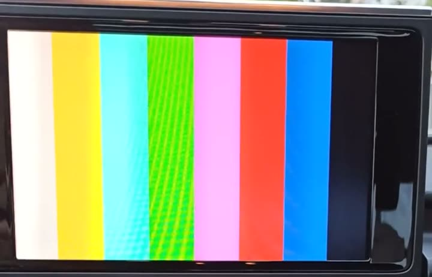

# lmprobe

Layer manager test without OpenGL: replays DrGER's `showScreen` call for
call, but draws eight colour bars straight into the VFB for 5 s and logs
every raw devctl status. It also saves the layer manager's state dump
(`read()` of `/dev/layermanager`, [docs/platform-notes.md §3.1](../../docs/platform-notes.md))
before, during and after the bars. In the default run.

- **Run:** `lmprobe <sd_path> [seconds]` (default 5)
- **Output:** `var/lmprobe.log`, `lmprobe_dshot.png`, `lmprobe_sshot.png`,
  `lmprobe_state_{before,shown,after}.txt`

## Verifies

- The `showScreen` sequence: unregister → register cid 40 flags 2 → `getVfb`
  → draw → `updateVfb` → show `{40,16,19}` → unregister.
- CPU drawing straight into the VFB.
- Layer manager screenshots of a CPU-drawn VFB.

## Results

**Works**
- Every step `rc=0`; layer manager 1.1; VFB 800×480 `BGRA8888`, stride 3200.
- The bars cover the HMI; the `d-shot` is exact and byte-identical between runs.
- The sequence lives on in `src/common/screen.c` and `src/common/gfx.c`.

**Expected, not errors**
- Unregister before register returns `EINVAL`: check the register `result`, not just the devctl return.

**Built, not yet run on the car**
- The state dump: the files, then in the log the layer lines, the
  displayables with their front/back sids, the foreground (layer 0) cid,
  `second read` (0 = the server keeps the file offset), and `foreground
  before X, after Y: restored`.
- `lm_get_vfb ... after update`: the sid should change (the VFB is
  double-buffered).

Details: [docs/platform-notes.md §3](../../docs/platform-notes.md).
